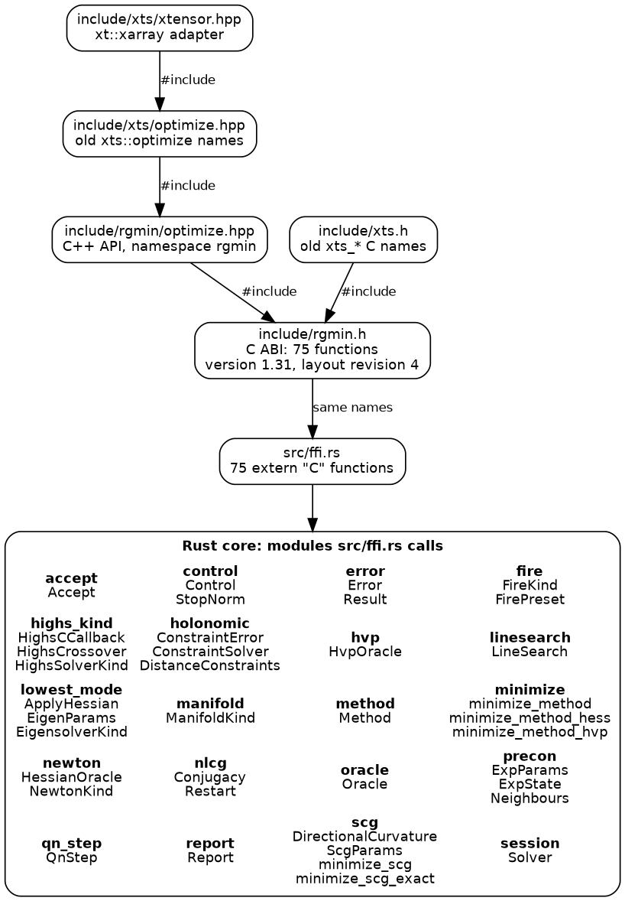

#+TITLE: Architecture
#+OPTIONS: toc:nil todo:nil num:nil author:nil title:nil
#+STARTUP: content

* Architecture

~rgmin~ has an hourglass interface, the design in [[https://github.com/CppCon/CppCon2014/tree/master/Presentations/Hourglass%20Interfaces%20for%20C%2B%2B%20APIs][Stefanus Du Toit's "Hourglass Interfaces for C++ APIs" (CppCon 2014)]].
The core of [[https://docs.metatensor.org/latest/devdoc/architecture.html][metatensor]] has the same layout: Rust behind a C interface, with a header-only C++ wrapper on top.
The wide top is the code that calls the solvers, the wide bottom is the Rust code that implements them, and the narrow middle, the /waist/, is one small C application binary interface (ABI) between them.
The waist is the only way from C and C++ to the solvers.
No solver is written a second time above it.
Rust hosts such as rgsaddle use the crate directly and never cross the waist.

** Layer diagram

#+CAPTION: C and C++ headers at the top, the C ABI in the middle, and the Rust modules it calls at the bottom.

The top row is the public headers under ~include/~ and the ~#include~ edges between them.
~include/rgmin.h~ declares the functions of the waist and ~src/ffi.rs~ defines the same ones.
The bottom box lists the modules ~src/ffi.rs~ takes types and functions from.
Every vector that crosses the waist is a DLPack ~DLManagedTensorVersioned~ from the *dlpk* crate, so a later device path keeps the same functions.

~docs/figures/architecture/draw_hourglass.py~ draws the figure from the headers and ~src/~ with Graphviz ~dot~.
It stops if the header and the Rust source name different functions.
Redraw the figure after changing a header or the C ABI:

#+begin_src bash
python3 docs/figures/architecture/draw_hourglass.py
#+end_src

** Objects

- =Lbfgs= :: Persistent pair history, two-loop recursion, eOn cap by default. ~LbfgsStep::Wolfe~ opts into the line search.
  Hopping chains hold this type (anneal ~WarmLbfgs~ is a handle).
- =Solver= :: Method-agnostic session. One =step= is one outer
  iteration. The C type =rgmin_solver_t= is a pointer to this.
- =minimize_method= :: Cold-start dispatch for every =Method=.
- =LineSearch::Wolfe= :: Nocedal-Wright 3.5 / 3.6. Default production
  choice for quasi-Newton directions.
- =Oracle= :: Closure adapter that implements
  =DifferentiableObjective= for a fused =(f, g)= function.
- =ecnoise= :: Moré–Wild difference table for the noise in an energy
  or in one projection of the gradient, plus the 2012 forward and
  gradient steps (Algorithm 5.1, not the noise table). One uniform
  projection has variance =tr(Σ) / n=. =Control::noise_floor= stops at
  =c * sqrt(n_free) * eps_g= with =Status::NoiseFloor=, after the
  =gtol= test. The same stop fires when a line search finds no trial
  whose decrease clears =c * eps_f=.
- =rgmin_solver_create= / =rgmin_solver_step= / =rgmin_solver_free= ::
  The session half of the waist.
  Callbacks are arguments of each step, not stored on the handle.
    =include/rgmin.h= sets =abi_major= 1, =abi_minor= 43 and =layout_revision= 5.
  =rgmin_abi_compatible= checks the major version and the layout revision only.
- =DistanceConstraints= :: Holonomic atom-pair distances for a session.
  SHAKE, LINCS and SETTLE return each trial to the set.
  The C type =rgmin_constraints_t= is a pointer to this.
- =ManifoldKind= :: Embedded geometry. Euclidean is the identity.
  Sphere, SO(3), Stiefel ~St(n,1)~, SE(3), Symmetric,
  SkewSymmetric, ComplexCircle ~(S^1)^n~, and EuclideanComplex
  ~C^n~ implement ~project~ / ~retract~ / ~transport~.
- =rgmin_minimize= :: First-order / quasi-Newton C entry. CPU f64
  tensors only; other devices return =RGMIN_UNSUPPORTED_DEVICE=.
- =rgmin_minimize_hess= :: Newton / RFO C entry. Caller supplies a
  dense row-major Hessian. This is a different solver, not an
  L-BFGS option.
- =Solver::set_precon= / =rgmin_solver_set_precon= :: Exp, Lindh, the
  bonded metric, or =select_precon=. ABI minor 32.
- =rgmin_solver_set_quickmin_variant= :: Quick-min options from C:
  =RGMIN_QUICKMIN_RGMIN=, =RGMIN_QUICKMIN_EON=,
  =RGMIN_QUICKMIN_PER_ATOM=. ABI minor 33.
  =rgmin_solver_precon_scale= is =μ= after the sine probe.
- =select_precon= :: L-BFGS and CG: Exp at 100 atoms for bulk,
  surface, and a metal cluster (ASE ~PreconLBFGS~). Lindh for a
  covalent molecule or cluster up to ~N_LINDH~. Bonded metric when
  that caller has a force field and every element is covalent.
  FIRE auto is the identity.

| C kind | Rust | role |
|---+---|---|
| =RGMIN_PRECON_EXP= | =PreconSpec::Exp= | =H_0 = P^{-1}= for L-BFGS, metric for CG and FIRE |
| =RGMIN_PRECON_LINDH= | =PreconSpec::Lindh= | model Hessian, same solve |
| =RGMIN_PRECON_FF= | =PreconSpec::Ff= | bonded metric, harmonic terms on the C struct |
| =RGMIN_PRECON_AUTO= | =select_precon= | the session method plus the how-to table |
| =RGMIN_PRECON_NONE= | =clear_precon= | drop the metric |

** What does not live here

- Simulated annealing, basin hopping, and catalogue logic stay in
  anneal.
- Objective algebra stays in eindir.
- Sketch-map style collective variables stay in landfold.
