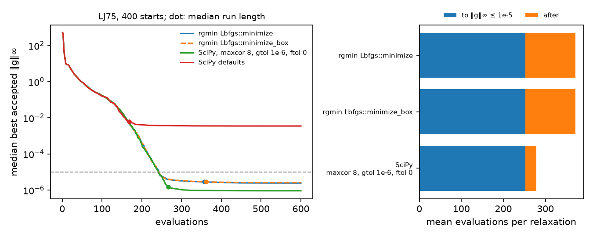

# State of the art

Every DOI on this page is in the `rgmin-docs` ookcite collection
and on after
`verify_references`.

## Unconstrained local minimization

The production method for a smooth unconstrained problem with an
analytic or fused gradient is limited-memory BFGS without a line
search. The eOn client does not line-search its L-BFGS step
(<https://github.com/TheochemUI/eOn>, `client/LBFGS.cpp`, commit
579738a9387e8d0ea55496f45dd057812cfab892; the client is described by
Chill et al., [10.1088/0965-0393/22/5/055002](https://doi.org/10.1088/0965-0393/22/5/055002)). The default cap is that
client's `max_move`, 0.2. The first step estimates curvature with a
finite difference of length 0.01 and sets `H0 = 1/C`. Later steps use
`(s · y) / (y · y)` when that quotient is positive, and the client's
`inverse_curvature` 0.01 otherwise. A proposal whose longest atom
move is at least the cap clears the memory and steps along `H0`
times the force (`distance_reset`). A direction that is not descent
does the same (`angle_reset`). Negative curvature clears the memory
and steps along the force at the cap. `LbfgsStep::Scaled` is the ASE
length control: shorten the two-loop step and keep the pairs.
`LbfgsStep::Wolfe` opts into the strong Wolfe search.
The force counts are `bench/results.md`.

-   Nocedal 1980 introduced the limited-memory update
    ([10.1090/s0025-5718-1980-0572855-7](https://doi.org/10.1090/s0025-5718-1980-0572855-7)).
-   Liu and Nocedal 1989 is the method used in practice
    ([10.1007/BF01589116](https://doi.org/10.1007/BF01589116)).
-   Nocedal and Wright, **Numerical Optimization**, chapter 7, records the
    two-loop recursion (algorithm 7.4) and the `H0 = ((s.y)/(y.y)) I`
    scale (7.20) ([10.1007/978-0-387-40065-5](https://doi.org/10.1007/978-0-387-40065-5)).
-   Wolfe 1969 is the curvature condition
    ([10.1137/1011036](https://doi.org/10.1137/1011036)). Algorithms 3.5 and 3.6 of Nocedal and Wright are
    the bracketing / zoom search.

Armijo alone is not enough for a quasi-Newton method. A pair that
decreases the value without measuring curvature poisons every later
direction. anneal measured that on Lennard-Jones 75: Armijo warm-start
was 1.8 times worse than discarding the memory; strong Wolfe reverses
the sign.

## Bound-constrained model

`Lbfgs.highs` keeps the two-loop direction and asks HiGHS only to
project it onto the trust region, the box, and any equalities
(`min 1/2 norm(p - d)^2`, `Q = I`;
[10.1007/s12532-017-0130-5](https://doi.org/10.1007/s12532-017-0130-5)).
A dense compact Hessian is not a production QP: after a short accepted
step it is indefinite and the HiGHS QP solver does not return.
landfold `--highs` is this projection, not sequential LP.

## Bound-constrained reference

SciPy's `scipy.optimize.minimize(..., method="L-BFGS-B")` is the Byrd,
Lu, Nocedal, Zhu algorithm
([10.1137/0916069](https://doi.org/10.1137/0916069)), with the Morales and Nocedal 2011 remark on the
Fortran 778 code ([10.1145/2049662.2049669](https://doi.org/10.1145/2049662.2049669)).
Its `gtol` is an infinity-norm on the projected gradient.
`Lbfgs` defaults to that same infinity-norm so a hopping polish is
comparable to L-BFGS-B.

`Lbfgs::minimize_box` is that algorithm in this crate: the generalized Cauchy point, the subspace step and the projection test ().

### Lennard-Jones, 75 atoms

The 75-atom Lennard-Jones (LJ75) protocol is anneal's `examples/warm_quench_lj.rs`: 400 relaxations from perturbed minima, overlaps repaired first, no bounds.
`examples/lbfgsb_bench.rs` rebuilds the same starts and traces rgmin.
`docs/figures/lbfgsb/bench_lbfgsb.py` runs SciPy 1.18.1 on those starts.
The `minimize` arm opts into `LbfgsStep::Wolfe`.
That is the strong Wolfe search these numbers record.
The default step stays the eOn cap, and this table does not time it.

<table border="2" cellspacing="0" cellpadding="6" rules="groups" frame="hsides">

<colgroup>
<col  class="org-left" />

<col  class="org-right" />

<col  class="org-right" />

<col  class="org-right" />

<col  class="org-right" />
</colgroup>
<thead>
<tr>
<th scope="col" class="org-left">arm</th>
<th scope="col" class="org-right">evaluations per relaxation</th>
<th scope="col" class="org-right">to <code>gmax &lt;= 1e-5</code></th>
<th scope="col" class="org-right">after</th>
<th scope="col" class="org-right">worst final <code>gmax</code></th>
</tr>
</thead>
<tbody>
<tr>
<td class="org-left"><code>Lbfgs::minimize</code> with <code>LbfgsStep::Wolfe</code></td>
<td class="org-right">314.4</td>
<td class="org-right">291.5</td>
<td class="org-right">22.9</td>
<td class="org-right">1.94e-5</td>
</tr>

<tr>
<td class="org-left"><code>Lbfgs::minimize_box</code></td>
<td class="org-right">314.3</td>
<td class="org-right">291.1</td>
<td class="org-right">23.1</td>
<td class="org-right">1.87e-5</td>
</tr>

<tr>
<td class="org-left">L-BFGS-B, <code>maxcor 8</code>, <code>gtol 1e-6</code>, <code>ftol 0</code></td>
<td class="org-right">278.5</td>
<td class="org-right">252.6</td>
<td class="org-right">25.9</td>
<td class="org-right">1.29e-5</td>
</tr>

<tr>
<td class="org-left">L-BFGS-B, SciPy defaults</td>
<td class="org-right">181.2</td>
<td class="org-right">not reached</td>
<td class="org-right">&#xa0;</td>
<td class="org-right">5.63e-2</td>
</tr>
</tbody>
</table>

`gmax` is the largest absolute gradient component at the last accepted iterate.
The "to" column counts evaluations up to the first accepted iterate with `gmax <= 1e-5`; every run of the first three arms gets there.
The "after" column is the mean of what each of those runs spends past that point.
The two rgmin arms end in the same minimum on all 400 starts.
rgmin and SciPy agree on 382 starts.
Of the other 18, SciPy finds the lower minimum on 9 and rgmin on 9.

This page used to give 386.1 against 273.
Those runs used anneal's pinned rgmin, and the SciPy options were not recorded.
The Wolfe search now takes 314.4 evaluations against SciPy's recorded
278.5, 1.13 times.

Bound handling is not the cause.
LJ75 has no bounds.
SciPy skips its Cauchy point when a problem has none (`mainlb` in `scipy/optimize/src/lbfgsb.c`, SciPy 1.18.1, commit e4e854ea), and `minimize_box` costs what the Wolfe `minimize` costs.
All three converged arms reach `gmax <= 1e-5`; the two rgmin arms now
take about 291 evaluations to get there.
The remaining difference is the end of the run.
Near `gmax = 1e-6` the energy, about -380, changes only in its last bits, so the strong Wolfe zoom cannot meet its tests.
Before the rounding stop it spent up to 40 evaluations, dropped the
pairs, and spent up to 40 more from steepest descent.
The search now follows the relative-bracket warning of More and Thuente
1994 ([10.1145/192115.192132](https://doi.org/10.1145/192115.192132)) and stops when the step or value
cannot be resolved at machine precision.
On the measured 400-run trace, 5.9 evaluations per relaxation come
after the last accepted iterate.
SciPy's More-Thuente search (`dcsrch`) returns a warning once rounding blocks progress, and `lnsrlb` takes that point as the step.
With `ftol = 0` the run then stops at the first step that does not lower f (115 of 400 runs), on the gradient test (284), or on a failed line search (1).
It spends 0.1 evaluations per relaxation after its last accepted iterate.
With SciPy's default `ftol` the run stops much earlier, at a median `gmax` of 5.7e-3, which is not a converged relaxation by this page's test.

Left: the median over the 400 starts of the best accepted `gmax` so far, against evaluations; a dot marks the median run length.
Right: mean evaluations before and after `gmax <= 1e-5`.
`docs/figures/lbfgsb/plot_lbfgsb.py` draws it from the two traces and prints the table above.

### A bounded problem

`driver1` of the L-BFGS-B 3.0 distribution is an extended Rosenbrock function on 25 variables.
The odd variables lie in [1, 100] and the even ones in [-100, 100].
The runs start from its own start, x = 3, and from 19 seeded starts in the box, with 5 pairs and a projected `gtol` of 1e-5.

<table border="2" cellspacing="0" cellpadding="6" rules="groups" frame="hsides">

<colgroup>
<col  class="org-left" />

<col  class="org-right" />

<col  class="org-right" />
</colgroup>
<thead>
<tr>
<th scope="col" class="org-left">arm</th>
<th scope="col" class="org-right">evaluations per run</th>
<th scope="col" class="org-right">worst final projected <code>gmax</code></th>
</tr>
</thead>
<tbody>
<tr>
<td class="org-left"><code>Lbfgs::minimize_box</code></td>
<td class="org-right">38.2</td>
<td class="org-right">9.87e-6</td>
</tr>

<tr>
<td class="org-left">L-BFGS-B, <code>ftol 0</code></td>
<td class="org-right">37.9</td>
<td class="org-right">9.78e-6</td>
</tr>

<tr>
<td class="org-left">L-BFGS-B, default <code>ftol</code></td>
<td class="org-right">34.0</td>
<td class="org-right">2.42e-4</td>
</tr>
</tbody>
</table>

All 20 runs of the first two arms meet the tolerance.
With its default `ftol`, SciPy stops first and none of its 20 runs meets it.

## Relative-decrease stop

The L-BFGS-B code also stops when one iteration lowers the value by
little relative to the value.
After a line search from `f_k` to `f_{k+1}`, `mainlb` in the 3.0
`lbfgsb.f` stops on this test
([10.1145/2049662.2049669](https://doi.org/10.1145/2049662.2049669)).

    f_k - f_{k+1} <= factr * eps * max(|f_k|, |f_{k+1}|, 1)

Its comments give `factr = 1e7` for moderate accuracy, and SciPy's
default `ftol` is that `factr` times the machine epsilon, about 2.22e-9.
`Lbfgs::ftol` is the same test, and its default of zero turns it off.
`LBFGSB_FTOL` is the SciPy value.
SciPy with `ftol = 0` still stops on a step that leaves the value
unchanged, while `Lbfgs` with `ftol = 0` skips the test.

`cargo run --release --example lbfgs_ftol` runs the default `Lbfgs` with
each setting.
The extended Rosenbrock runs start from `(-1.2, 1, -1.2, 1, ...)`, and
the Lennard-Jones (LJ) runs start from a cubic grid of spacing 1.1 with
a small jitter.

<table border="2" cellspacing="0" cellpadding="6" rules="groups" frame="hsides">

<colgroup>
<col  class="org-left" />

<col  class="org-right" />

<col  class="org-right" />

<col  class="org-right" />
</colgroup>
<thead>
<tr>
<th scope="col" class="org-left">problem</th>
<th scope="col" class="org-right">evals, <code>ftol = 0</code></th>
<th scope="col" class="org-right">evals, <code>LBFGSB_FTOL</code></th>
<th scope="col" class="org-right">final <code>gmax</code>, <code>LBFGSB_FTOL</code></th>
</tr>
</thead>
<tbody>
<tr>
<td class="org-left">Rosenbrock, 2</td>
<td class="org-right">49</td>
<td class="org-right">48</td>
<td class="org-right">1.96e-5</td>
</tr>

<tr>
<td class="org-left">Rosenbrock, 10</td>
<td class="org-right">92</td>
<td class="org-right">87</td>
<td class="org-right">1.33e-4</td>
</tr>

<tr>
<td class="org-left">Rosenbrock, 100</td>
<td class="org-right">635</td>
<td class="org-right">620</td>
<td class="org-right">1.31e-4</td>
</tr>

<tr>
<td class="org-left">LJ7</td>
<td class="org-right">58</td>
<td class="org-right">45</td>
<td class="org-right">2.33e-4</td>
</tr>

<tr>
<td class="org-left">LJ13</td>
<td class="org-right">135</td>
<td class="org-right">101</td>
<td class="org-right">1.23e-3</td>
</tr>

<tr>
<td class="org-left">LJ38</td>
<td class="org-right">415</td>
<td class="org-right">316</td>
<td class="org-right">3.42e-3</td>
</tr>
</tbody>
</table>

Every `ftol = 0` run ends with `norminf(g) < 1e-6`.
The test saves the most on the clusters, where `|f|` is well above one.
On LJ38 it saves 99 evaluations and ends 7.7e-6 above the energy of the
`ftol = 0` run.
A caller that needs the gradient below `gtol` keeps `ftol` at zero.

## Capped step for atomistic L-BFGS

`LbfgsStep::Capped` drops the line search. The two-loop direction
keeps the Nocedal-Wright scale `H0 = ((s · y) / (y · y)) I`
(equation 7.20). The step is shortened so the longest per-atom
displacement is at most the caller's cap, which is the ASE LBFGS
length control with the line search left off. An empty memory
steps along the force at that length. Pairs stay in the memory
when the step is shortened. The geometry step selected by
`set_atom_maxmove` still clears that memory when the quasi-Newton
step is longer than its cap, and it can spend further evaluations
on backtracking. The capped rule does neither.

`LbfgsStep::Scaled` is the step in the table below, not the default.
The default is the eOn reset described above.
`LbfgsStep::Wolfe` is the opt-in search, and `set_atom_maxmove`
selects the geometry step only after that opt-in. The cap is 0.2,
the eOn `max_move` and the length ASE publishes as `maxstep`, and it
is not refitted per problem.
`cargo run --release --example lbfgs_capped` repeats each arm
seven times, serially, and the wall time below is the median.
Evaluations do not change across repeats. Wolfe and capped rows
are `Lbfgs` with memory 8 and stop on `norminf(g) < 1e-6`. Their
gradient column is that norm. Session rows use memory 20 and stop
on the largest atomic force, 0.01. Their gradient column is that
force. Wolfe's evaluation counts are the counts already recorded
for `develop`.

<table border="2" cellspacing="0" cellpadding="6" rules="groups" frame="hsides">

<colgroup>
<col  class="org-left" />

<col  class="org-left" />

<col  class="org-right" />

<col  class="org-right" />

<col  class="org-right" />

<col  class="org-right" />
</colgroup>
<thead>
<tr>
<th scope="col" class="org-left">problem</th>
<th scope="col" class="org-left">arm</th>
<th scope="col" class="org-right">evals</th>
<th scope="col" class="org-right">median ms</th>
<th scope="col" class="org-right">gradient</th>
<th scope="col" class="org-right">value</th>
</tr>
</thead>
<tbody>
<tr>
<td class="org-left">Rosenbrock 2</td>
<td class="org-left">Wolfe</td>
<td class="org-right">49</td>
<td class="org-right">0.012</td>
<td class="org-right">1.74e-7</td>
<td class="org-right">8.82e-16</td>
</tr>

<tr>
<td class="org-left">Rosenbrock 2</td>
<td class="org-left">capped</td>
<td class="org-right">46</td>
<td class="org-right">0.023</td>
<td class="org-right">1.33e-9</td>
<td class="org-right">6.75e-21</td>
</tr>

<tr>
<td class="org-left">Rosenbrock 2</td>
<td class="org-left">geometry</td>
<td class="org-right">99</td>
<td class="org-right">0.050</td>
<td class="org-right">1.08e-3</td>
<td class="org-right">2.36e-9</td>
</tr>

<tr>
<td class="org-left">Rosenbrock 2</td>
<td class="org-left">capped session</td>
<td class="org-right">45</td>
<td class="org-right">0.071</td>
<td class="org-right">3.24e-3</td>
<td class="org-right">6.80e-9</td>
</tr>

<tr>
<td class="org-left">Rosenbrock 10</td>
<td class="org-left">Wolfe</td>
<td class="org-right">92</td>
<td class="org-right">0.037</td>
<td class="org-right">5.55e-7</td>
<td class="org-right">3.01e-16</td>
</tr>

<tr>
<td class="org-left">Rosenbrock 10</td>
<td class="org-left">capped</td>
<td class="org-right">83</td>
<td class="org-right">0.056</td>
<td class="org-right">3.16e-7</td>
<td class="org-right">3.986579</td>
</tr>

<tr>
<td class="org-left">Rosenbrock 10</td>
<td class="org-left">geometry</td>
<td class="org-right">155</td>
<td class="org-right">0.149</td>
<td class="org-right">8.38e-3</td>
<td class="org-right">4.50e-8</td>
</tr>

<tr>
<td class="org-left">Rosenbrock 10</td>
<td class="org-left">capped session</td>
<td class="org-right">68</td>
<td class="org-right">0.140</td>
<td class="org-right">5.98e-3</td>
<td class="org-right">3.986579</td>
</tr>

<tr>
<td class="org-left">Rosenbrock 100</td>
<td class="org-left">Wolfe</td>
<td class="org-right">635</td>
<td class="org-right">1.019</td>
<td class="org-right">5.70e-7</td>
<td class="org-right">7.06e-15</td>
</tr>

<tr>
<td class="org-left">Rosenbrock 100</td>
<td class="org-left">capped</td>
<td class="org-right">562</td>
<td class="org-right">1.363</td>
<td class="org-right">8.18e-7</td>
<td class="org-right">3.986624</td>
</tr>

<tr>
<td class="org-left">Rosenbrock 100</td>
<td class="org-left">geometry</td>
<td class="org-right">863</td>
<td class="org-right">3.139</td>
<td class="org-right">8.49e-3</td>
<td class="org-right">7.03e-7</td>
</tr>

<tr>
<td class="org-left">Rosenbrock 100</td>
<td class="org-left">capped session</td>
<td class="org-right">539</td>
<td class="org-right">2.783</td>
<td class="org-right">8.40e-3</td>
<td class="org-right">3.986624</td>
</tr>

<tr>
<td class="org-left">LJ7</td>
<td class="org-left">Wolfe</td>
<td class="org-right">58</td>
<td class="org-right">0.028</td>
<td class="org-right">7.75e-7</td>
<td class="org-right">-15.59321</td>
</tr>

<tr>
<td class="org-left">LJ7</td>
<td class="org-left">capped</td>
<td class="org-right">50</td>
<td class="org-right">0.058</td>
<td class="org-right">7.75e-7</td>
<td class="org-right">-15.59321</td>
</tr>

<tr>
<td class="org-left">LJ7</td>
<td class="org-left">geometry</td>
<td class="org-right">26</td>
<td class="org-right">0.038</td>
<td class="org-right">9.82e-3</td>
<td class="org-right">-15.59320</td>
</tr>

<tr>
<td class="org-left">LJ7</td>
<td class="org-left">capped session</td>
<td class="org-right">40</td>
<td class="org-right">0.086</td>
<td class="org-right">7.26e-3</td>
<td class="org-right">-15.59321</td>
</tr>

<tr>
<td class="org-left">LJ13</td>
<td class="org-left">Wolfe</td>
<td class="org-right">135</td>
<td class="org-right">0.133</td>
<td class="org-right">5.45e-7</td>
<td class="org-right">-38.20651</td>
</tr>

<tr>
<td class="org-left">LJ13</td>
<td class="org-left">capped</td>
<td class="org-right">149</td>
<td class="org-right">0.230</td>
<td class="org-right">7.89e-7</td>
<td class="org-right">-38.20651</td>
</tr>

<tr>
<td class="org-left">LJ13</td>
<td class="org-left">geometry</td>
<td class="org-right">96</td>
<td class="org-right">0.270</td>
<td class="org-right">4.82e-3</td>
<td class="org-right">-38.20651</td>
</tr>

<tr>
<td class="org-left">LJ13</td>
<td class="org-left">capped session</td>
<td class="org-right">106</td>
<td class="org-right">0.330</td>
<td class="org-right">6.31e-3</td>
<td class="org-right">-38.20650</td>
</tr>

<tr>
<td class="org-left">LJ38</td>
<td class="org-left">Wolfe</td>
<td class="org-right">415</td>
<td class="org-right">1.695</td>
<td class="org-right">8.84e-7</td>
<td class="org-right">-168.2171</td>
</tr>

<tr>
<td class="org-left">LJ38</td>
<td class="org-left">capped</td>
<td class="org-right">366</td>
<td class="org-right">1.803</td>
<td class="org-right">7.59e-7</td>
<td class="org-right">-165.1035</td>
</tr>

<tr>
<td class="org-left">LJ38</td>
<td class="org-left">geometry</td>
<td class="org-right">211</td>
<td class="org-right">1.620</td>
<td class="org-right">9.77e-3</td>
<td class="org-right">-165.3536</td>
</tr>

<tr>
<td class="org-left">LJ38</td>
<td class="org-left">capped session</td>
<td class="org-right">187</td>
<td class="org-right">1.439</td>
<td class="org-right">9.06e-3</td>
<td class="org-right">-161.0777</td>
</tr>

<tr>
<td class="org-left">Morse Pt256</td>
<td class="org-left">geometry</td>
<td class="org-right">11</td>
<td class="org-right">4.945</td>
<td class="org-right">5.47e-3</td>
<td class="org-right">-1396.173</td>
</tr>

<tr>
<td class="org-left">Morse Pt256</td>
<td class="org-left">capped session</td>
<td class="org-right">11</td>
<td class="org-right">4.965</td>
<td class="org-right">3.94e-3</td>
<td class="org-right">-1396.173</td>
</tr>
</tbody>
</table>

The chained Rosenbrock function
`sum_i (1 - x_i)^2 + 100 (x_{i+1} - x_i^2)^2` has a local minimum
for every `n >= 4` in the basin of `(-1, 1, ..., 1)`.
SciPy BFGS started at that point converges with a positive definite
Hessian. For `n = 4` the value is 3.701 and the first coordinate
is −0.776. For `n = 10` the value is 3.987 and the first coordinate
is −0.993, near `(-1, 1, ..., 1)` with value about 3.98.
For `n = 3` that start falls through to the valley floor at 0.
A step that stops at this local minimum has converged.
From the alternating start `(-1.2, 1, -1.2, 1, ...)` the capped
step enters that minimum for `n = 10` and `n = 100`, while the
Wolfe search and the geometry step reach value 0.
On LJ7 and LJ13, at an atomic force of 0.01, the geometry step
uses fewer evaluations and finishes at the same energy. On LJ38
the capped session uses 187 evaluations against 211 and finishes
about 4.3 energy units higher, in another basin. On the periodic
Morse cluster both session arms take 11 evaluations and the same
energy. The cap is the default because the eOn client does not
line-search this step. The fifty-start comparison is
`benches/ase_h2h/distribution.md`.

The same fmax and the same maxstep against ASE 3.29.0 are recorded
in `benches/ase_h2h/results.md`.

## Newton and RFO when the Hessian is cheap

L-BFGS is the production method when only `f` and `∇f` are available.
When a dense Hessian is cheap (analytic pair potential, model Hessian),
the direction is a Newton step, not a two-loop pair history.

-   Banerjee, Adams, Simons, Shepard 1985 is rational function
    optimization
    ([10.1021/j100247a015](https://doi.org/10.1021/j100247a015)).
-   Baker 1986 is the restricted-step form used in geometry codes
    ([10.1002/jcc.540070402](https://doi.org/10.1002/jcc.540070402)).
-   Nocedal and Wright, chapter 3 / 6, record the Levenberg-shifted
    Newton step `(H + μ I)^{-1} g`.

`Method::newton(NewtonKind::Shifted | NewtonKind::Rfo)` and
`minimize_newton` are that solver. The C waist is
`rgmin_minimize_hess`. It is not an L-BFGS option.

## What beat OptBench min, and what did not

Chill OptBench min, repo INIs (LJ38 `norm2(F) = 0.01`, Morse
`1e-3`), 100/100 clusters. Force-call averages on converged
runs. OPTIM 2014 is 176 / 46.

Beat rematch (104 / 34):

<table border="2" cellspacing="0" cellpadding="6" rules="groups" frame="hsides">

<colgroup>
<col  class="org-left" />

<col  class="org-left" />

<col  class="org-left" />

<col  class="org-left" />
</colgroup>
<thead>
<tr>
<th scope="col" class="org-left">arm</th>
<th scope="col" class="org-left">LJ38</th>
<th scope="col" class="org-left">Morse</th>
<th scope="col" class="org-left">vs rematch</th>
</tr>
</thead>
<tbody>
<tr>
<td class="org-left">xtsci rematch L-BFGS</td>
<td class="org-left">104 (0/100)</td>
<td class="org-left">34 (0/100)</td>
<td class="org-left">bar</td>
</tr>

<tr>
<td class="org-left">native rematch L-BFGS</td>
<td class="org-left">104 (0/100)</td>
<td class="org-left">35 (0/100)</td>
<td class="org-left">tie / +1</td>
</tr>

<tr>
<td class="org-left">xtsci dogleg on <code>pair_full</code></td>
<td class="org-left">81 (0/100)</td>
<td class="org-left">45 (0/100)</td>
<td class="org-left">beats LJ38 / does not beat Morse</td>
</tr>
</tbody>
</table>

Do not beat rematch (100/100 unless noted):

<table border="2" cellspacing="0" cellpadding="6" rules="groups" frame="hsides">

<colgroup>
<col  class="org-left" />

<col  class="org-left" />

<col  class="org-left" />
</colgroup>
<thead>
<tr>
<th scope="col" class="org-left">arm</th>
<th scope="col" class="org-left">LJ38</th>
<th scope="col" class="org-left">Morse</th>
</tr>
</thead>
<tbody>
<tr>
<td class="org-left">OPTIM 2014</td>
<td class="org-left">176</td>
<td class="org-left">46</td>
</tr>

<tr>
<td class="org-left">local L-BFGS</td>
<td class="org-left">174</td>
<td class="org-left">52</td>
</tr>

<tr>
<td class="org-left">xtsci Newton <code>pair_full</code></td>
<td class="org-left">360</td>
<td class="org-left">203 (1 fail)</td>
</tr>

<tr>
<td class="org-left">xtsci rematch + HiGHS</td>
<td class="org-left">153 (3 fail)</td>
<td class="org-left">0 conv (300 s timeout)</td>
</tr>

<tr>
<td class="org-left">xtsci BB</td>
<td class="org-left">491</td>
<td class="org-left">65</td>
</tr>

<tr>
<td class="org-left">local FIRE</td>
<td class="org-left">767</td>
<td class="org-left">156</td>
</tr>

<tr>
<td class="org-left">xtsci FIRE</td>
<td class="org-left">767</td>
<td class="org-left">156</td>
</tr>

<tr>
<td class="org-left">xtsci FIRE 2.0</td>
<td class="org-left">715</td>
<td class="org-left">166</td>
</tr>

<tr>
<td class="org-left">xtsci RFO</td>
<td class="org-left">22298 (13 fail)</td>
<td class="org-left">210 (4 fail)</td>
</tr>

<tr>
<td class="org-left">local CG</td>
<td class="org-left">449</td>
<td class="org-left">106</td>
</tr>

<tr>
<td class="org-left">xtsci Hager–Zhang</td>
<td class="org-left">13859 (20 fail)</td>
<td class="org-left">5336 (10 fail)</td>
</tr>

<tr>
<td class="org-left">xtsci Liu–Storey</td>
<td class="org-left">13877 (12 fail)</td>
<td class="org-left">5321 (10 fail)</td>
</tr>

<tr>
<td class="org-left">xtsci FR-PR</td>
<td class="org-left">14487 (12 fail)</td>
<td class="org-left">5182 (10 fail)</td>
</tr>

<tr>
<td class="org-left">xtsci Polak–Ribiere</td>
<td class="org-left">14541 (8 fail)</td>
<td class="org-left">5095 (10 fail)</td>
</tr>

<tr>
<td class="org-left">xtsci Hestenes–Stiefel</td>
<td class="org-left">14220 (14 fail)</td>
<td class="org-left">6474 (10 fail)</td>
</tr>

<tr>
<td class="org-left">xtsci L-BFGS (no pair)</td>
<td class="org-left">11144 (1 fail)</td>
<td class="org-left">4538 (10 fail)</td>
</tr>

<tr>
<td class="org-left">xtsci rematch + Schlegel</td>
<td class="org-left">4560 (7 fail)</td>
<td class="org-left">0 conv (300 s timeout)</td>
</tr>

<tr>
<td class="org-left">xtsci rematch + Lindh full</td>
<td class="org-left">10726 (11 fail)</td>
<td class="org-left">0 conv (300 s timeout)</td>
</tr>

<tr>
<td class="org-left">xtsci rematch + Swart</td>
<td class="org-left">13466 (18 fail)</td>
<td class="org-left">0 conv (300 s timeout)</td>
</tr>

<tr>
<td class="org-left">xtsci rematch + Fischer</td>
<td class="org-left">30961 (12 fail)</td>
<td class="org-left">0 conv (300 s timeout)</td>
</tr>

<tr>
<td class="org-left">xtsci BFGS</td>
<td class="org-left">31539 (9 fail)</td>
<td class="org-left">15380 (12 fail)</td>
</tr>

<tr>
<td class="org-left">xtsci steepest</td>
<td class="org-left">161337 (14 fail)</td>
<td class="org-left">11685 (11 fail)</td>
</tr>

<tr>
<td class="org-left">xtsci SR1</td>
<td class="org-left">46440 (13 fail)</td>
<td class="org-left">32040 (38 fail)</td>
</tr>

<tr>
<td class="org-left">xtsci SR2 (old map)</td>
<td class="org-left">fail 100/100</td>
<td class="org-left">15079 (67 fail)</td>
</tr>

<tr>
<td class="org-left">xtsci Adam</td>
<td class="org-left">437284 (23 fail)</td>
<td class="org-left">20727 (1 fail)</td>
</tr>

<tr>
<td class="org-left">xtsci conjugate descent</td>
<td class="org-left">357370 (83 fail)</td>
<td class="org-left">33779 (31 fail)</td>
</tr>

<tr>
<td class="org-left">xtsci Dai–Yuan</td>
<td class="org-left">332068 (93 fail)</td>
<td class="org-left">31329 (47 fail)</td>
</tr>

<tr>
<td class="org-left">xtsci Fletcher–Reeves</td>
<td class="org-left">429282 (97 fail)</td>
<td class="org-left">44414 (69 fail)</td>
</tr>

<tr>
<td class="org-left">xtsci PSO</td>
<td class="org-left">fail 100/100</td>
<td class="org-left">fail 100/100</td>
</tr>

<tr>
<td class="org-left">sphere / Stiefel</td>
<td class="org-left">fail 100/100 (maxiter)</td>
<td class="org-left">maxiter ~11000 FC, 0 conv</td>
</tr>

<tr>
<td class="org-left">SO(3)</td>
<td class="org-left">reject <code>n!=9</code></td>
<td class="org-left">not a 3N packing</td>
</tr>

<tr>
<td class="org-left">SE(3)</td>
<td class="org-left">reject <code>n!=12</code></td>
<td class="org-left">not a 3N packing</td>
</tr>

<tr>
<td class="org-left">rigidquotient / mwrigid</td>
<td class="org-left">Sella / IRC</td>
<td class="org-left">LJ38 20/20 identical to rematch (avg 120); Morse PBC T(3) 0/20 fail, 19/20 identical FC</td>
</tr>
</tbody>
</table>

Dogleg is the only token that beats rematch, and only on LJ38.
HiGHS on rematch is 153 on LJ38: better than OPTIM, worse than
rematch, 3 failures. Model Hessians do not beat pair. Manifold
tokens do not converge on these cluster / bulk geometries.

****Failure audit (12 agents per method)****

<table border="2" cellspacing="0" cellpadding="6" rules="groups" frame="hsides">

<colgroup>
<col  class="org-left" />

<col  class="org-left" />

<col  class="org-left" />

<col  class="org-left" />
</colgroup>
<thead>
<tr>
<th scope="col" class="org-left">method</th>
<th scope="col" class="org-left">Borda</th>
<th scope="col" class="org-left">Class</th>
<th scope="col" class="org-left">Evidence</th>
</tr>
</thead>
<tbody>
<tr>
<td class="org-left">SO(3)</td>
<td class="org-left">11/12 crash bug</td>
<td class="org-left"><code>n!=9</code> is <code>Error::ManifoldDim</code></td>
<td class="org-left"><code>so3.rs</code> <code>required_dim</code>; <code>pack</code> is never called on 3N</td>
</tr>

<tr>
<td class="org-left">SE(3)</td>
<td class="org-left">10/12 contract</td>
<td class="org-left"><code>n!=12</code> is <code>Error::ManifoldDim</code></td>
<td class="org-left"><code>se3.rs</code> exact-12; no 9-prefix</td>
</tr>

<tr>
<td class="org-left">sphere</td>
<td class="org-left">12/12 misuse</td>
<td class="org-left">impl correct, <code>S^{3N-1}</code></td>
<td class="org-left"><code>sphere.rs:22-39</code>; cluster not on the unit sphere</td>
</tr>

<tr>
<td class="org-left">Stiefel</td>
<td class="org-left">12/12 alias</td>
<td class="org-left"><code>St(n,1)</code> = sphere</td>
<td class="org-left"><code>stiefel.rs:11-23</code>; <code>stiefel_p</code> is always 1</td>
</tr>

<tr>
<td class="org-left">HiGHS</td>
<td class="org-left">9/12 wrong QP</td>
<td class="org-left"><code>step_hess</code> solves dense Newton QP</td>
<td class="org-left"><code>session.rs:322-336</code>; Morse <code>n=768</code> times out</td>
</tr>

<tr>
<td class="org-left">PSO</td>
<td class="org-left">10/12 wrong tool</td>
<td class="org-left">swarm on <code>[-1e12,1e12]</code></td>
<td class="org-left"><code>oracle.rs</code> unbounded; <code>230021 = 10000 x ~23</code></td>
</tr>

<tr>
<td class="org-left">SR2</td>
<td class="org-left">fixed</td>
<td class="org-left">Powell symmetric Broyden in the SR1 trust region</td>
<td class="org-left"><code>qn.rs</code> <code>sr2_hessian_update</code></td>
</tr>

<tr>
<td class="org-left">model Hessians</td>
<td class="org-left">11/12 wrong chemistry</td>
<td class="org-left">covalent <code>B^T k B</code> vs pair</td>
<td class="org-left">pair is the rematch <code>P</code></td>
</tr>
</tbody>
</table>

SO(3) and SE(3) reject a 3N cluster. Sphere/Stiefel on 3N stay
on `S^{3N-1}` and die on maxiter. Isolated molecules use
`rigid_quotient` or `mw_rigid`. PSO force
counts match `max_iterations` (10000 LJ38 / 1000 Morse) times
swarm work, not a 230x230 product. SR2 is Powell's symmetric Broyden
update in the SR1 trust region; the old rank-1 map failed the secant
condition.

## FIRE, Barzilai–Borwein, and dogleg

These four tokens share `rgmin_solver_t` and a fused `(f, g)`.

-   FIRE (Bitzek 2006,
    [10.1103/PhysRevLett.97.170201](https://doi.org/10.1103/PhysRevLett.97.170201)) is the ASE / LAMMPS / eOn
    inertial stepper. One fused force per geometry.
-   FIRE 2.0 (Guénolé 2020,
    [10.1016/j.commatsci.2020.109584](https://doi.org/10.1016/j.commatsci.2020.109584)) uses semi-implicit Euler:
    update velocity, mix it toward the force, then update position.  On
    non-positive power it applies the paper's half-step-back correction;
    a nonzero correction gets a fresh force before the forward step.
    The initial delay leaves the time step unchanged during the first
    delay window, and a clipped forward move rescales the stored velocity
    to the displacement actually taken.  More than 2,000 consecutive
    non-positive-power steps terminate as a stalled solve. An installed
    exponential preconditioner leaves that order in place and uses `P`
    as the metric: power is `F · v`, and the kick and the mix use
    `P^{-1} F`.
-   `FirePreset::Guenole2020` (`set_fire_preset`, opt-in) takes
    Guenole 2020 Table 1 (arXiv:1908.02038v4, page 7), the LAMMPS
    `min_modify` defaults: `tmax` 10 and `tmin` 0.02 times the start
    step, `delaystep` 20, `dtgrow` 1.1, `dtshrink` 0.5, `alpha0` 0.25,
    `alphashrink` 0.99, `vdfmax` 2000, half step back and initial
    delay on, semi-implicit Euler. A shrink that would pass `dt_min`
    keeps `dt` (Algorithm 2, line 23). The default set has
    `dt_max = 2.5 istep`, `dt_min = 1e-12`, `N_delay = 5` and
    `alpha_start = 0.1`, and clamps the shrink at `dt_min`.
    Under the preset or ABC the session keeps its velocity unless a
    cap or a bound moved the trial, since `(x + dx - x) / dt` rounds
    `v` by about `u |x| / |dx|`.
-   ABC-FIRE is the accelerated bias-corrected (ABC) update of
    Echeverri Restrepo and Andric 2023
    ([10.1016/j.commatsci.2022.111978](https://doi.org/10.1016/j.commatsci.2022.111978)).
    The opt-in setter `set_fire_abc` turns it on for `fire2` only.
    The update sets `alpha` to at least `1e-10` before the mix. It then
    divides the mixed velocity by `1 - (1 - alpha)^(N+1)`, where `N` is
    the count of consecutive positive-power steps. Each velocity
    component is then clipped to the cap over `dt`, and the cap
    bounds each displacement component. This follows ASE 3.30.0b1
    `ase/optimize/fire2.py` (`use_abc`). LAMMPS `src/min_fire.cpp`
    (commit `9ce13d52`) uses the same floor and clip, with exponent
    `ntimestep - last_negative`, one less than ASE.
-   `src/fire.rs` replays ASE `FIRE2` on the extended Rosenbrock
    function (`tests/ase_fire2_gold.py`) one step at a time, with and
    without ABC. ASE has neither the initial delay nor `vdfmax` and
    clamps the shrink, so the script checks that power stays positive
    for the first 20 steps and that no shrink reaches `dt_min`.
-   Barzilai–Borwein (1988,
    [10.1093/imanum/8.1.141](https://doi.org/10.1093/imanum/8.1.141)) with Raydan's nonmonotone globalization
    ([10.1137/S1052623494266365](https://doi.org/10.1137/S1052623494266365)) is a two-point spectral step.
-   Powell dogleg (Nocedal–Wright algorithm 4.1) consumes the host
    pair Hessian already passed to `rgmin_solver_step_hess`.
-   Steihaug–Toint Newton-CG (`newton-cg`, and `newton-pcg` with a
    rank-16 Nyström preconditioner) is a session method. Hessian
    access is a product: analytic through `step_hvp`, otherwise one
    forward difference of the gradient. `maxmove` is the Euclidean
    trust ceiling; a per-atom cap clips the trial only.
    Steihaug 1983
    ([10.1137/0720042](https://doi.org/10.1137/0720042)),
    Nocedal–Wright chapter 7.

ARC, DFP, SPSA, CMA-ES, Nelder–Mead, and BOBYQA were surveyed and
not added: DFP is dominated by BFGS already in the crate, and the
derivative-free methods waste force calls on an analytic PES.

## Nonlinear CG

Hager and Zhang 2005 (`CG_DESCENT`)
([10.1137/030601880](https://doi.org/10.1137/030601880)) is the cheapest NLCG on this protocol
(13859 / 5336) and does not beat rematch L-BFGS.

## Embedded manifolds

The session retracts onto an embedded manifold when the host
asks. The geometry is manoptcpp `proj` / `retr` / `transp` on a
rank-1 f64 vector.

-   Absil, Mahony, Sepulchre 2008 is the matrix-manifold
    reference
    ([10.1515/9781400830244](https://doi.org/10.1515/9781400830244)).
-   Riemannian conjugate gradients use that retraction and that transport.
    The transport is scaled when the image is longer than the vector it carried (Ring and Wirth 2012, [10.1137/11082885X](https://doi.org/10.1137/11082885X); Sato and Iwai 2015, [10.1080/02331934.2013.836650](https://doi.org/10.1080/02331934.2013.836650); Sato 2016, [10.1007/s10589-015-9801-1](https://doi.org/10.1007/s10589-015-9801-1); Sato 2022, [10.1007/978-3-030-62391-3](https://doi.org/10.1007/978-3-030-62391-3)).
-   Boumal 2023 is the smooth-manifold course
    ([10.1017/9781009166164](https://doi.org/10.1017/9781009166164)).
-   Manopt (Boumal, Mishra, Absil, Sepulchre 2014) is the
    factory contract this crate ports
    ([JMLR 15, 1455 (2014)](https://jmlr.org/papers/v15/boumal14a.html)).
-   ROPTLIB (Huang, Absil, Gallivan, Hand 2018) is the C++
    library that names Stiefel and SE(3) in the same waist
    ([10.1145/3218822](https://doi.org/10.1145/3218822)).

`minimize_rlbfgs` is cautious limited-memory Riemannian BFGS,
Algorithm 2 of Huang, Absil, and Gallivan 2018
([10.1137/17M1127582](https://doi.org/10.1137/17M1127582)).
The two-loop map is Huang, Gallivan, and Absil 2015
([10.1137/140955483](https://doi.org/10.1137/140955483)).
On Euclidean space the transport is the identity and the update is
the cautious BFGS method of Li and Fukushima 2001
([10.1137/S1052623499354242](https://doi.org/10.1137/S1052623499354242)).
The section 7 choices are memory 4, `vartheta(t) = 10^{-4} t`, an
Armijo–Goldstein backtrack from a unit trial, and the stop
`||g_f|| / ||g_0|| < 10^{-6}`. The vector transport is the parallel
transport of the exponential when that pair exists. This is not the
sphere great-circle search, and the default Euclidean L-BFGS step
stays the eOn cap.

Euclidean is the default. An isolated molecule uses
`RigidQuotient` (`R^{3N}/SE(3)`; Sella Cartesian
`fix_translation` / `fix_rotation`,
https://doi.org/10.1021/acs.jctc.2c00395) or `MwRigid` (Page–McIver
mass-weighted Eckart, https://doi.org/10.1063/1.454172). Sphere, SO(3) as a
9-vector, Stiefel `St(n,1)`, SE(3) as a 12-vector, and SPD as
an n² row-major matrix are matrix-manifold embeddings and
reject a 3N cluster.

## Defaults in this crate

-   Method: `Lbfgs` / `Method::lbfgs_with_memory(8)`, line-search-free
    cap `EON_MAX_MOVE` (0.2)
-   Opt-in line search: `LbfgsStep::Wolfe`, constants `c1 = 1e-4`,
    `c2 = 0.9`, at most 20 trials
-   First trial of that search: `1` when the memory is occupied;
    the initial step length when the memory is empty
-   Relative-decrease stop: off on `Lbfgs` (`ftol: 0.0`);
    `LBFGSB_FTOL` is the SciPy L-BFGS-B default
-   Gradient stop: `norminf(g) < 1e-6` on `Lbfgs`, `norm2(g)` on
    `minimize_lbfgs` so existing cold-start reports stay comparable
-   Session stop: `norm2(g) < gtol` by default. `Control::stop_norm`
    or `Solver::set_stop_norm` selects the largest per-atom norm (ASE
    `fmax`, eOn `max_atom`, LAMMPS `max`), the largest component (eOn
    `max_component`, LAMMPS `inf`) or `norm2(g) / sqrt(n)` (eOn `rms`)

## A-posteriori nonlinear certificates

`certificate` combines caller-supplied majorants in standard `f64`
floating-point arithmetic without outward rounding:

-   `kantorovich_ball` evaluates the classical Newton&#x2013;Kantorovich
    existence radius `2 eta / (1 + sqrt(1 - 2 h))` under `h <= 1/2`
    (Kantorovich and Akilov 1982,
    [10.1016/B978-0-08-023036-8.50024-2](https://doi.org/10.1016/B978-0-08-023036-8.50024-2); Gragg and Tapia 1974,
    [10.1137/0711002](https://doi.org/10.1137/0711002)) .
    Because `r <= 2 eta` whenever `h <= 1/2`, an induced operator-norm
    Lipschitz bound for `J` on `B(x0, 2 eta)` suffices.
-   `adjoint_functional_bar` adds the dual-weighted residual
    `first_order = |lambda^T F(x0)|` for an exact adjoint
    `J(x0)^T lambda = grad q(x0)` to the nonlinear displacement and
    quadratic Taylor remainders, using the dual norm for `grad q(x0)`
    and the induced operator norm for `D^2 q` (Becker and Rannacher
    2001, [10.1017/S0962492901000010](https://doi.org/10.1017/S0962492901000010))
    .
-   `certify_morse_gap` certifies that a projected self-adjoint operator
    cannot cross zero inside the Kantorovich ball by Weyl's eigenvalue
    perturbation inequality (Weyl 1912,
    [10.1007/BF01456804](https://doi.org/10.1007/BF01456804))
    ,
    requiring `operator_lipschitz` to bound the spectral-norm Lipschitz
    constant of the operator.
