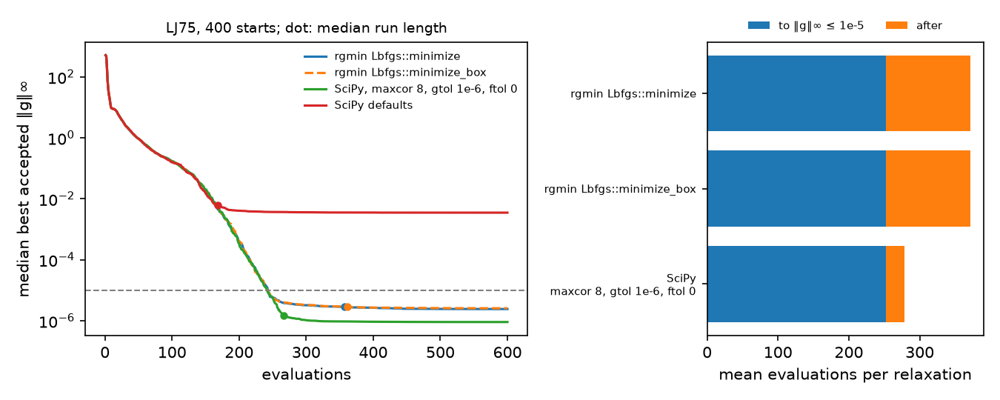

State of the art
----------------

Every DOI on this page is in the ``rgmin-docs`` ookcite collection
and on `reference/bibliography <bibliography.rst>`_ after
``verify_references``.

Unconstrained local minimization
~~~~~~~~~~~~~~~~~~~~~~~~~~~~~~~~

The production method for a smooth unconstrained problem with an
analytic or fused gradient is limited-memory BFGS with the strong Wolfe
conditions.

- Nocedal 1980 introduced the limited-memory update
  (`10.1090/s0025-5718-1980-0572855-7 <https://doi.org/10.1090/s0025-5718-1980-0572855-7>`_).

- Liu and Nocedal 1989 is the method used in practice
  (`10.1007/BF01589116 <https://doi.org/10.1007/BF01589116>`_).

- Nocedal and Wright, **Numerical Optimization**, chapter 7, records the
  two-loop recursion (algorithm 7.4) and the ``H0 = ((s.y)/(y.y)) I``
  scale (7.20) (`10.1007/978-0-387-40065-5 <https://doi.org/10.1007/978-0-387-40065-5>`_).

- Wolfe 1969 is the curvature condition
  (`10.1137/1011036 <https://doi.org/10.1137/1011036>`_). Algorithms 3.5 and 3.6 of Nocedal and Wright are
  the bracketing / zoom search.

Armijo alone is not enough for a quasi-Newton method. A pair that
decreases the value without measuring curvature poisons every later
direction. anneal measured that on Lennard-Jones 75: Armijo warm-start
was 1.8 times worse than discarding the memory; strong Wolfe reverses
the sign.

Bound-constrained model
~~~~~~~~~~~~~~~~~~~~~~~

``Lbfgs.highs`` keeps the two-loop direction and asks HiGHS only to
project it onto the trust region, the box, and any equalities
(``min 1/2 norm(p - d)^2``, ``Q = I``;
`10.1007/s12532-017-0130-5 <https://doi.org/10.1007/s12532-017-0130-5>`_).
A dense compact Hessian is not a production QP: after a short accepted
step it is indefinite and the HiGHS QP solver does not return.
landfold ``--highs`` is this projection, not sequential LP.

Bound-constrained reference
~~~~~~~~~~~~~~~~~~~~~~~~~~~

SciPy's ``scipy.optimize.minimize(..., method="L-BFGS-B")`` is the Byrd,
Lu, Nocedal, Zhu algorithm
(`10.1137/0916069 <https://doi.org/10.1137/0916069>`_), with the Morales and Nocedal 2011 remark on the
Fortran 778 code (`10.1145/2049662.2049669 <https://doi.org/10.1145/2049662.2049669>`_).
Its ``gtol`` is an infinity-norm on the projected gradient.
``Lbfgs`` defaults to that same infinity-norm so a hopping polish is
comparable to L-BFGS-B.
``Lbfgs::minimize_box`` is that algorithm in this crate: the generalized Cauchy point, the subspace step and the projection test (:doc:`../howto/lbfgs-box`).

Lennard-Jones, 75 atoms
^^^^^^^^^^^^^^^^^^^^^^^

The 75-atom Lennard-Jones (LJ75) protocol is anneal's ``examples/warm_quench_lj.rs``: 400 relaxations from perturbed minima, overlaps repaired first, no bounds.
``examples/lbfgsb_bench.rs`` rebuilds the same starts and traces rgmin.
``docs/figures/lbfgsb/bench_lbfgsb.py`` runs SciPy 1.18.1 on those starts.
rgmin is ``develop`` at d27b2387 with ``minimize_box`` added; the ``minimize`` arm computes the same bits as ``develop``.

.. table::

    +---------------------------------------------------+----------------------------+---------------------+-------+----------------------+
    | arm                                               | evaluations per relaxation | to ``gmax <= 1e-5`` | after | worst final ``gmax`` |
    +===================================================+============================+=====================+=======+======================+
    | ``Lbfgs::minimize``                               |                      371.2 |               252.3 | 118.8 |              2.11e-5 |
    +---------------------------------------------------+----------------------------+---------------------+-------+----------------------+
    | ``Lbfgs::minimize_box``                           |                      371.0 |               251.8 | 119.2 |              2.67e-5 |
    +---------------------------------------------------+----------------------------+---------------------+-------+----------------------+
    | L-BFGS-B, ``maxcor 8``, ``gtol 1e-6``, ``ftol 0`` |                      278.5 |               252.6 |  25.9 |              1.29e-5 |
    +---------------------------------------------------+----------------------------+---------------------+-------+----------------------+
    | L-BFGS-B, SciPy defaults                          |                      181.2 |         not reached | \     |              5.63e-2 |
    +---------------------------------------------------+----------------------------+---------------------+-------+----------------------+

``gmax`` is the largest absolute gradient component at the last accepted iterate.
The "to" column counts evaluations up to the first accepted iterate with ``gmax <= 1e-5``; every run of the first three arms gets there.
The "after" column is the mean of what each of those runs spends past that point.
The two rgmin arms end in the same minimum on all 400 starts.
rgmin and SciPy agree on 382 starts.
Of the other 18, SciPy finds the lower minimum on 9 and rgmin on 9.

This page used to give 386.1 against 273.
Those runs used anneal's pinned rgmin, and the SciPy options were not recorded.
The re-measured gap is 371.2 against 278.5, 1.33 times.

Bound handling is not the cause.
LJ75 has no bounds.
SciPy skips its Cauchy point when a problem has none (``mainlb`` in ``scipy/optimize/src/lbfgsb.c``, SciPy 1.18.1, commit e4e854ea), and ``minimize_box`` costs what ``minimize`` costs.
All three converged arms reach ``gmax <= 1e-5`` after about 252 evaluations.
The difference is the end of the run.
Near ``gmax = 1e-6`` the energy, about -380, changes only in its last bits, so the strong Wolfe zoom cannot meet its tests.
It spends up to 40 evaluations, drops the pairs, and spends up to 40 more from steepest descent before it stops.
On average 68.3 evaluations per relaxation come after the last accepted iterate.
SciPy's More-Thuente search (``dcsrch``) returns a warning once rounding blocks progress, and ``lnsrlb`` takes that point as the step.
With ``ftol = 0`` the run then stops at the first step that does not lower f (115 of 400 runs), on the gradient test (284), or on a failed line search (1).
It spends 0.1 evaluations per relaxation after its last accepted iterate.
With SciPy's default ``ftol`` the run stops much earlier, at a median ``gmax`` of 5.7e-3, which is not a converged relaxation by this page's test.

Left: the median over the 400 starts of the best accepted ``gmax`` so far, against evaluations; a dot marks the median run length.
Right: mean evaluations before and after ``gmax <= 1e-5``.
``docs/figures/lbfgsb/plot_lbfgsb.py`` draws it from the two traces and prints the table above.

A bounded problem
^^^^^^^^^^^^^^^^^

``driver1`` of the L-BFGS-B 3.0 distribution is an extended Rosenbrock function on 25 variables.
The odd variables lie in [1, 100] and the even ones in [-100, 100].
The runs start from its own start, x = 3, and from 19 seeded starts in the box, with 5 pairs and a projected ``gtol`` of 1e-5.

.. table::

    +----------------------------+---------------------+--------------------------------+
    | arm                        | evaluations per run | worst final projected ``gmax`` |
    +============================+=====================+================================+
    | ``Lbfgs::minimize_box``    |                38.2 |                        9.87e-6 |
    +----------------------------+---------------------+--------------------------------+
    | L-BFGS-B, ``ftol 0``       |                37.9 |                        9.78e-6 |
    +----------------------------+---------------------+--------------------------------+
    | L-BFGS-B, default ``ftol`` |                34.0 |                        2.42e-4 |
    +----------------------------+---------------------+--------------------------------+

All 20 runs of the first two arms meet the tolerance.
With its default ``ftol``, SciPy stops first and none of its 20 runs meets it.

Newton and RFO when the Hessian is cheap
~~~~~~~~~~~~~~~~~~~~~~~~~~~~~~~~~~~~~~~~

L-BFGS is the production method when only ``f`` and ``∇f`` are available.
When a dense Hessian is cheap (analytic pair potential, model Hessian),
the direction is a Newton step, not a two-loop pair history.

- Banerjee, Adams, Simons, Shepard 1985 is rational function
  optimization
  (`10.1021/j100247a015 <https://doi.org/10.1021/j100247a015>`_).

- Baker 1986 is the restricted-step form used in geometry codes
  (`10.1002/jcc.540070402 <https://doi.org/10.1002/jcc.540070402>`_).

- Nocedal and Wright, chapter 3 / 6, record the Levenberg-shifted
  Newton step ``(H + μ I)^{-1} g``.

``Method::Newton { kind: NewtonKind::Shifted | NewtonKind::Rfo }`` and
``minimize_newton`` are that solver. The C waist is
``rgmin_minimize_hess``. It is not an L-BFGS option.

What beat OptBench min, and what did not
~~~~~~~~~~~~~~~~~~~~~~~~~~~~~~~~~~~~~~~~

Chill OptBench min, repo INIs (LJ38 ``norm2(F) = 0.01``, Morse
``1e-3``), 100/100 clusters. Force-call averages on converged
runs. OPTIM 2014 is 176 / 46.

Beat rematch (104 / 34):

.. table::

    +-------------------------------+-------------+------------+----------------------------------+
    | arm                           | LJ38        | Morse      | vs rematch                       |
    +===============================+=============+============+==================================+
    | xtsci rematch L-BFGS          | 104 (0/100) | 34 (0/100) | bar                              |
    +-------------------------------+-------------+------------+----------------------------------+
    | native rematch L-BFGS         | 104 (0/100) | 35 (0/100) | tie / +1                         |
    +-------------------------------+-------------+------------+----------------------------------+
    | xtsci dogleg on ``pair_full`` | 81 (0/100)  | 45 (0/100) | beats LJ38 / does not beat Morse |
    +-------------------------------+-------------+------------+----------------------------------+

Do not beat rematch (100/100 unless noted):

.. table::

    +---------------------------------------------+------------------------+-----------------------------------------------------------------------------------------+
    | arm                                         | LJ38                   | Morse                                                                                   |
    +=============================================+========================+=========================================================================================+
    | OPTIM 2014                                  | 176                    | 46                                                                                      |
    +---------------------------------------------+------------------------+-----------------------------------------------------------------------------------------+
    | local L-BFGS                                | 174                    | 52                                                                                      |
    +---------------------------------------------+------------------------+-----------------------------------------------------------------------------------------+
    | xtsci Newton ``pair_full``                  | 360                    | 203 (1 fail)                                                                            |
    +---------------------------------------------+------------------------+-----------------------------------------------------------------------------------------+
    | xtsci rematch + HiGHS                       | 153 (3 fail)           | 0 conv (300 s timeout)                                                                  |
    +---------------------------------------------+------------------------+-----------------------------------------------------------------------------------------+
    | xtsci BB                                    | 491                    | 65                                                                                      |
    +---------------------------------------------+------------------------+-----------------------------------------------------------------------------------------+
    | local FIRE                                  | 767                    | 156                                                                                     |
    +---------------------------------------------+------------------------+-----------------------------------------------------------------------------------------+
    | xtsci FIRE                                  | 767                    | 156                                                                                     |
    +---------------------------------------------+------------------------+-----------------------------------------------------------------------------------------+
    | xtsci FIRE 2.0                              | 715                    | 166                                                                                     |
    +---------------------------------------------+------------------------+-----------------------------------------------------------------------------------------+
    | xtsci RFO                                   | 22298 (13 fail)        | 210 (4 fail)                                                                            |
    +---------------------------------------------+------------------------+-----------------------------------------------------------------------------------------+
    | local CG                                    | 449                    | 106                                                                                     |
    +---------------------------------------------+------------------------+-----------------------------------------------------------------------------------------+
    | xtsci Hager–Zhang                           | 13859 (20 fail)        | 5336 (10 fail)                                                                          |
    +---------------------------------------------+------------------------+-----------------------------------------------------------------------------------------+
    | xtsci Liu–Storey                            | 13877 (12 fail)        | 5321 (10 fail)                                                                          |
    +---------------------------------------------+------------------------+-----------------------------------------------------------------------------------------+
    | xtsci FR-PR                                 | 14487 (12 fail)        | 5182 (10 fail)                                                                          |
    +---------------------------------------------+------------------------+-----------------------------------------------------------------------------------------+
    | xtsci Polak–Ribiere                         | 14541 (8 fail)         | 5095 (10 fail)                                                                          |
    +---------------------------------------------+------------------------+-----------------------------------------------------------------------------------------+
    | xtsci Hestenes–Stiefel                      | 14220 (14 fail)        | 6474 (10 fail)                                                                          |
    +---------------------------------------------+------------------------+-----------------------------------------------------------------------------------------+
    | xtsci L-BFGS (no pair)                      | 11144 (1 fail)         | 4538 (10 fail)                                                                          |
    +---------------------------------------------+------------------------+-----------------------------------------------------------------------------------------+
    | xtsci rematch + Schlegel                    | 4560 (7 fail)          | 0 conv (300 s timeout)                                                                  |
    +---------------------------------------------+------------------------+-----------------------------------------------------------------------------------------+
    | xtsci rematch + Lindh full                  | 10726 (11 fail)        | 0 conv (300 s timeout)                                                                  |
    +---------------------------------------------+------------------------+-----------------------------------------------------------------------------------------+
    | xtsci rematch + Swart                       | 13466 (18 fail)        | 0 conv (300 s timeout)                                                                  |
    +---------------------------------------------+------------------------+-----------------------------------------------------------------------------------------+
    | xtsci rematch + Fischer                     | 30961 (12 fail)        | 0 conv (300 s timeout)                                                                  |
    +---------------------------------------------+------------------------+-----------------------------------------------------------------------------------------+
    | xtsci BFGS                                  | 31539 (9 fail)         | 15380 (12 fail)                                                                         |
    +---------------------------------------------+------------------------+-----------------------------------------------------------------------------------------+
    | xtsci steepest                              | 161337 (14 fail)       | 11685 (11 fail)                                                                         |
    +---------------------------------------------+------------------------+-----------------------------------------------------------------------------------------+
    | xtsci SR1                                   | 46440 (13 fail)        | 32040 (38 fail)                                                                         |
    +---------------------------------------------+------------------------+-----------------------------------------------------------------------------------------+
    | xtsci SR2 (old map)                         | fail 100/100           | 15079 (67 fail)                                                                         |
    +---------------------------------------------+------------------------+-----------------------------------------------------------------------------------------+
    | xtsci Adam                                  | 437284 (23 fail)       | 20727 (1 fail)                                                                          |
    +---------------------------------------------+------------------------+-----------------------------------------------------------------------------------------+
    | xtsci conjugate descent                     | 357370 (83 fail)       | 33779 (31 fail)                                                                         |
    +---------------------------------------------+------------------------+-----------------------------------------------------------------------------------------+
    | xtsci Dai–Yuan                              | 332068 (93 fail)       | 31329 (47 fail)                                                                         |
    +---------------------------------------------+------------------------+-----------------------------------------------------------------------------------------+
    | xtsci Fletcher–Reeves                       | 429282 (97 fail)       | 44414 (69 fail)                                                                         |
    +---------------------------------------------+------------------------+-----------------------------------------------------------------------------------------+
    | xtsci PSO                                   | fail 100/100           | fail 100/100                                                                            |
    +---------------------------------------------+------------------------+-----------------------------------------------------------------------------------------+
    | sphere / Stiefel                            | fail 100/100 (maxiter) | maxiter ~11000 FC, 0 conv                                                               |
    +---------------------------------------------+------------------------+-----------------------------------------------------------------------------------------+
    | SO(3)                                       | reject ``n!=9``        | not a 3N packing                                                                        |
    +---------------------------------------------+------------------------+-----------------------------------------------------------------------------------------+
    | SE(3)                                       | reject ``n!=12``       | not a 3N packing                                                                        |
    +---------------------------------------------+------------------------+-----------------------------------------------------------------------------------------+
    | rigid\ :sub:`quotient`\ / mw\ :sub:`rigid`\ | Sella / IRC            | LJ38 20/20 identical to rematch (avg 120); Morse PBC T(3) 0/20 fail, 19/20 identical FC |
    +---------------------------------------------+------------------------+-----------------------------------------------------------------------------------------+

Dogleg is the only token that beats rematch, and only on LJ38.
HiGHS on rematch is 153 on LJ38: better than OPTIM, worse than
rematch, 3 failures. Model Hessians do not beat pair. Manifold
tokens do not converge on these cluster / bulk geometries.

****Failure audit (12 agents per method)****

.. table::

    +----------------+-----------------------+--------------------------------------+-------------------------------------------------------------+
    | method         | Borda                 | Class                                | Evidence                                                    |
    +================+=======================+======================================+=============================================================+
    | SO(3)          | 11/12 crash bug       | ``n!=9`` is ``Error::ManifoldDim``   | ``so3.rs`` ``required_dim``; ``pack`` is never called on 3N |
    +----------------+-----------------------+--------------------------------------+-------------------------------------------------------------+
    | SE(3)          | 10/12 contract        | ``n!=12`` is ``Error::ManifoldDim``  | ``se3.rs`` exact-12; no 9-prefix                            |
    +----------------+-----------------------+--------------------------------------+-------------------------------------------------------------+
    | sphere         | 12/12 misuse          | impl correct, ``S^{3N-1}``           | ``sphere.rs:22-39``; cluster not on the unit sphere         |
    +----------------+-----------------------+--------------------------------------+-------------------------------------------------------------+
    | Stiefel        | 12/12 alias           | ``St(n,1)`` = sphere                 | ``stiefel.rs:11-23``; ``stiefel_p`` is always 1             |
    +----------------+-----------------------+--------------------------------------+-------------------------------------------------------------+
    | HiGHS          | 9/12 wrong QP         | ``step_hess`` solves dense Newton QP | ``session.rs:322-336``; Morse ``n=768`` times out           |
    +----------------+-----------------------+--------------------------------------+-------------------------------------------------------------+
    | PSO            | 10/12 wrong tool      | swarm on ``[-1e12,1e12]``            | ``oracle.rs`` unbounded; ``230021 = 10000 x ~23``           |
    +----------------+-----------------------+--------------------------------------+-------------------------------------------------------------+
    | SR2 (old map)  | 8/12 bad update       | non-secant rank-1                    | ``sr2.hpp`` ``B += δ(y+Bs)^T / (δ·s)``                      |
    +----------------+-----------------------+--------------------------------------+-------------------------------------------------------------+
    | model Hessians | 11/12 wrong chemistry | covalent ``B^T k B`` vs pair         | pair is the rematch ``P``                                   |
    +----------------+-----------------------+--------------------------------------+-------------------------------------------------------------+

SO(3) and SE(3) reject a 3N cluster. Sphere/Stiefel on 3N stay
on ``S^{3N-1}`` and die on maxiter. Isolated molecules use
``rigid_quotient`` or ``mw_rigid``. PSO force
counts match ``max_iterations`` (10000 LJ38 / 1000 Morse) times
swarm work, not a 230x230 product.

SR2 was the ``sr2.hpp`` rank-1 map ``B += δ (y + Bs)^T / (δ·s)``. That
map failed the secant condition. SR2 is now Powell's symmetrization
with ``c = y + Bs``, so ``B+ s = y`` and ``B+`` is symmetric. With
``a = s·y`` and ``b = s·Bs`` both nonzero, it is the Broyden class
(Nocedal-Wright 6.32) with ``φ = a(a-b)/(a+b)^2``. It is not Powell
symmetric Broyden (``c = s``). The LJ38 row ``fail 100/100`` and the
Morse row ``15079 (67 fail)`` are the old map. The new update is
``sr2_hessian_update`` in ``qn.rs:291-306``.

FIRE, Barzilai–Borwein, and dogleg
~~~~~~~~~~~~~~~~~~~~~~~~~~~~~~~~~~

These four tokens share ``rgmin_solver_t`` and a fused ``(f, g)``.

- FIRE (Bitzek 2006,
  `10.1103/PhysRevLett.97.170201 <https://doi.org/10.1103/PhysRevLett.97.170201>`_) is the ASE / LAMMPS / eOn
  inertial stepper. One fused force per geometry.

- FIRE 2.0 (Guénolé 2020,
  `10.1016/j.commatsci.2020.109584 <https://doi.org/10.1016/j.commatsci.2020.109584>`_) uses semi-implicit Euler:
  update velocity, mix it toward the force, then update position. On
  non-positive power it applies the paper's half-step-back correction;
  a nonzero correction gets a fresh force before the forward step.
  The initial delay leaves the time step unchanged during the first
  delay window, and a clipped forward move rescales the stored velocity
  to the displacement actually taken. More than 2,000 consecutive
  non-positive-power steps terminate as a stalled solve. An installed
  exponential preconditioner leaves that order in place and uses ``P``
  as the metric: power is ``F · v``, and the kick and the mix use
  ``P^{-1} F``.

- Barzilai–Borwein (1988,
  `10.1093/imanum/8.1.141 <https://doi.org/10.1093/imanum/8.1.141>`_) with Raydan's nonmonotone globalization
  (`10.1137/S1052623494266365 <https://doi.org/10.1137/S1052623494266365>`_) is a two-point spectral step.

- Powell dogleg (Nocedal–Wright algorithm 4.1) consumes the host
  pair Hessian already passed to ``rgmin_solver_step_hess``.

Steihaug–Toint, ARC, DFP, SPSA, CMA-ES, Nelder–Mead, and BOBYQA
were surveyed and not added: DFP is dominated by BFGS already
in the crate, the derivative-free methods waste force calls on
an analytic PES, and Steihaug lost the fourth token slot to
FIRE 2.0.

Nonlinear CG
~~~~~~~~~~~~

Hager and Zhang 2005 (``CG_DESCENT``)
(`10.1137/030601880 <https://doi.org/10.1137/030601880>`_) is the cheapest NLCG on this protocol
(13859 / 5336) and does not beat rematch L-BFGS.

Embedded manifolds
~~~~~~~~~~~~~~~~~~

The session retracts onto an embedded manifold when the host
asks. The geometry is manopt\ :sub:`cpp`\ ``proj`` / ``retr`` / ``transp`` on a
rank-1 f64 vector.

- Absil, Mahony, Sepulchre 2008 is the matrix-manifold
  reference
  (`10.1515/9781400830244 <https://doi.org/10.1515/9781400830244>`_).

- Boumal 2023 is the smooth-manifold course
  (`10.1017/9781009166164 <https://doi.org/10.1017/9781009166164>`_).

- Manopt (Boumal, Mishra, Absil, Sepulchre 2014) is the
  factory contract this crate ports
  (`10.5555/2627435.2638581 <https://doi.org/10.5555/2627435.2638581>`_).

- ROPTLIB (Huang, Absil, Gallivan, Hand 2018) is the C++
  library that names Stiefel and SE(3) in the same waist
  (`10.1145/3218822 <https://doi.org/10.1145/3218822>`_).

Euclidean is the default. An isolated molecule uses
``RigidQuotient`` (``R^{3N}/SE(3)``; Sella Cartesian
``fix_translation`` / ``fix_rotation``,
https://doi.org/10.1021/acs.jctc.2c00395) or ``MwRigid`` (Page–McIver
mass-weighted Eckart, https://doi.org/10.1063/1.454172). Sphere, SO(3) as a
9-vector, Stiefel ``St(n,1)``, SE(3) as a 12-vector, and SPD as
an n² row-major matrix are matrix-manifold embeddings and
reject a 3N cluster.

Defaults in this crate
~~~~~~~~~~~~~~~~~~~~~~

- Method: ``Lbfgs`` / ``Method::Lbfgs { memory: 8 }``

- Line search: ``LineSearch::Wolfe { c1: 1e-4, c2: 0.9, maxiter: 20 }``

- First trial step: ``1`` when the memory is occupied (the Newton step);
  ``1 / norm(d)`` when the memory is empty (raw steepest descent)

- Gradient stop: ``norminf(g) < 1e-6`` on ``Lbfgs``, ``norm2(g)`` on
  ``minimize_lbfgs`` so existing cold-start reports stay comparable
